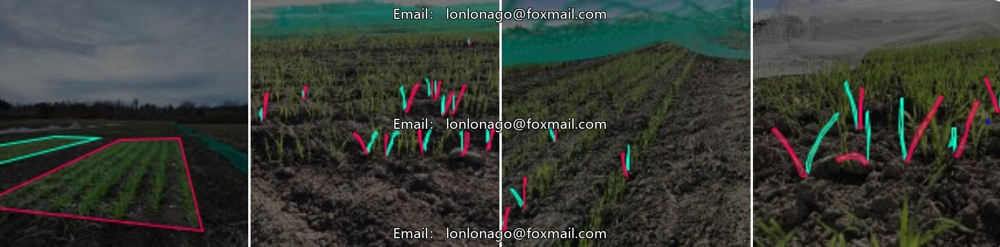
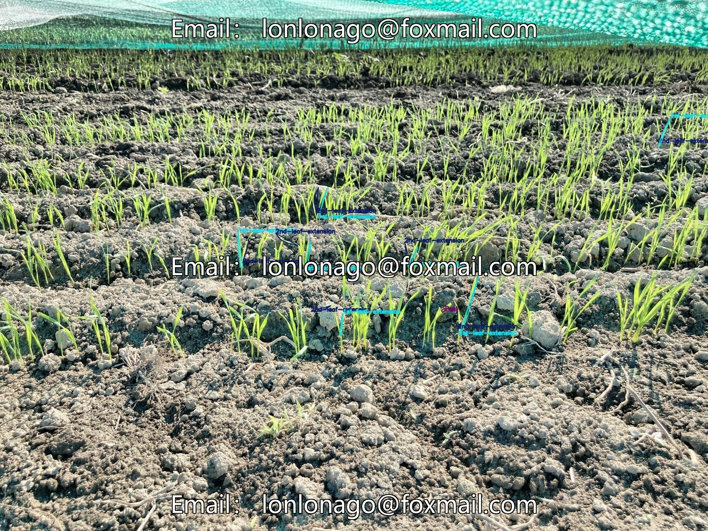
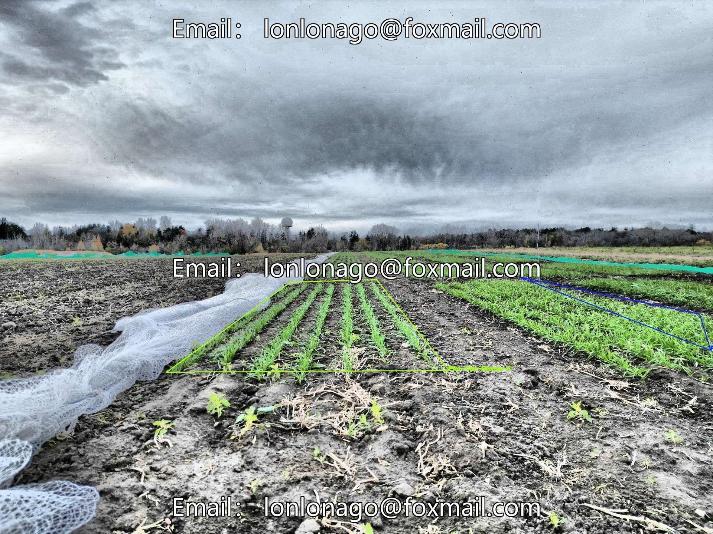
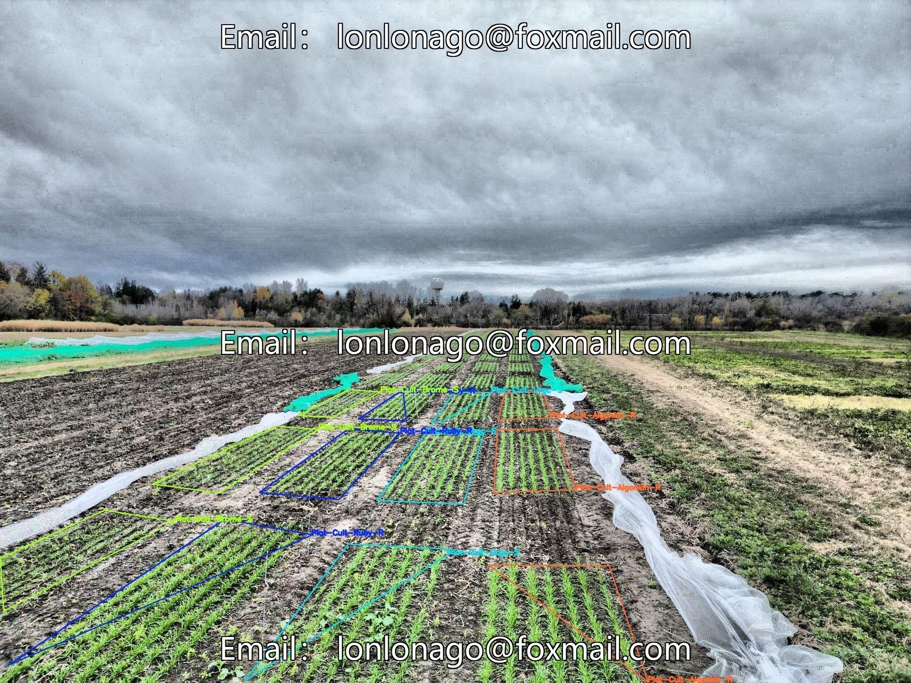
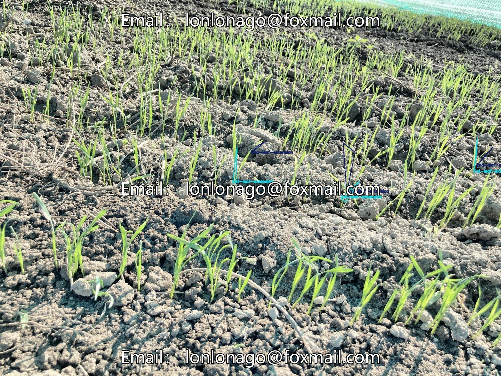

# Intelligent Agriculture Crop Growth State Identification Dataset, Issue 10657, Including Wheat and Others

## Body

Intelligent Agriculture Crop Growth Status Identification Dataset, Issue 10657. This dataset includes images of various stages of crop growth (germination, seedling stage, growing period, flowering period, fruiting period, maturity) for crops such as wheat, totaling 1700 high-quality annotated images in the format of Yolo+VOC, supporting training with mainstream detection models.

The dataset covers various agricultural fields, soils, and lighting scenarios. The annotation is completed by agricultural experts, with accurate labels and balanced category distribution. It is suitable for applications such as automated monitoring of growth status, yield prediction, and precision agriculture decision-making.

Virtual materials, once sold, are non-refundable.
Interested friends, click "I want" to proceed.

## Images

## Payment

Here is a pay link on Stripe ( https://buy.stripe.com/3cs8yP7sY87d0vu9AB ). Please contact me lonlonago@foxmail.com after funding $89, and I will send you a complete data files , thank you!

